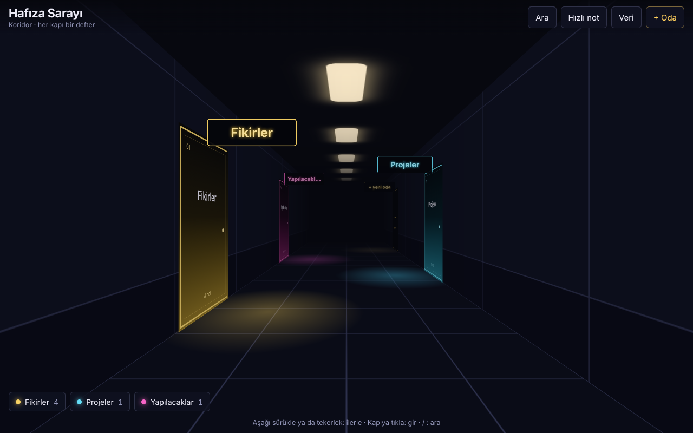
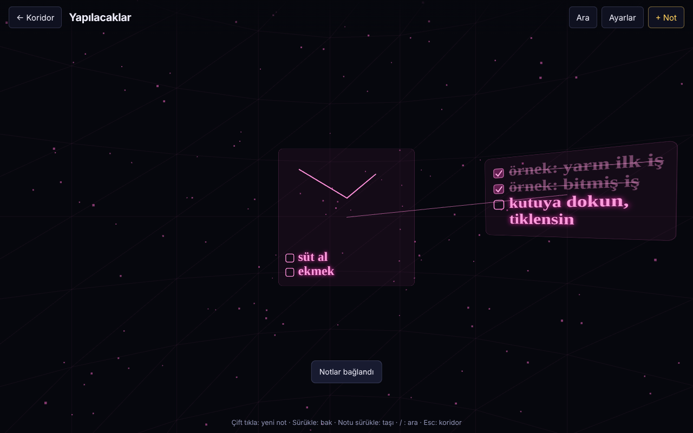

# Hafıza Sarayı

Tarayıcıda çalışan 3B hafıza sarayı not defteri. Koridorda yürürsün, her kapı bir defterdir, odaların içinde notlar seni saran bir kürenin üzerinde durur.

**Canlı sürüm:** https://aerenengineer.github.io/hafiza-sarayi/




Tek dosyadır: `index.html`. Kurulum yok, GitHub Pages ile doğrudan yayınlanır.

## Özellikler

- Koridor ve odalar, sürükleyerek gezinme, telefonda dokunmatik ve iki parmakla zoom
- Tikli madde listeleri (`[ ]` ile başlayan satırlar), nota resim ve çizim ekleme
- Notlar arası bağlantı ipleri, notu başka odaya taşıma
- Tüm odalarda arama (`/`), koridordan hızlı not (Gelen kutusu odası)
- Oda ayarları: ad, renk, gökyüzü, ortam sesi, ses düzeyi
- Ortam sesleri tarayıcıda üretilir (deniz, yağmur, fırtına, rüzgâr, kuşlar, gece, şömine, dere, uzay gemisi, saat); kendi ses dosyanı ekleyebilir ya da mikrofondan kaydedebilirsin
- Telefonu ~3 saniye sallayınca notlar yere dökülür, tekrar sallayınca toplanır
- Jiroskopla bakma, sesle yazma (tarayıcı destekliyorsa)
- Cihazlar arası senkron: GitHub hesabındaki gizli bir Gist üzerinden

## Senkron kurulumu

1. GitHub → Settings → Developer settings → Personal access tokens → yalnızca `gist` yetkili bir token oluştur.
2. Uygulamada **Veri** → token'ı yapıştır → **Bağlan**.
3. Diğer cihazda aynı token'ı gir.

Token yalnızca o tarayıcıda saklanır. Kendi ses dosyaların cihazda kalır, senkronlanmaz.

## Geliştirme

Kaynak `hafiza-sarayi.html` dosyasıdır. `python3 build.py` bunu `index.html` olarak paketler. Kaynağı değiştirdikten sonra paketlemeyi unutma, yayınlanan dosya `index.html`.

3B çizim için three.js r128 ve yazı tipleri CDN'den yüklenir, bu yüzden sayfa çevrimdışı açılmaz.

## Testler

Playwright ile başsız Chromium'da çalışır: masaüstü özellikleri, senkron ve birleştirme mantığı, telefon boyutunda dokunmatik.

```
npm install
npx playwright install chromium
npm test
```

GitHub Gist API'si testlerde taklit edilir, gerçek hesaba dokunulmaz. Ekran görüntüleri `tests/out/` altına yazılır.

Testlerin kapsamadığı kısımlar: gerçek telefon sensörleri (sallama ve jiroskop yapay olaylarla denenir), sesle yazma ve gerçek GitHub'a karşı senkron.

## Lisans

MIT. Ayrıntı için `LICENSE` dosyasına bak.
